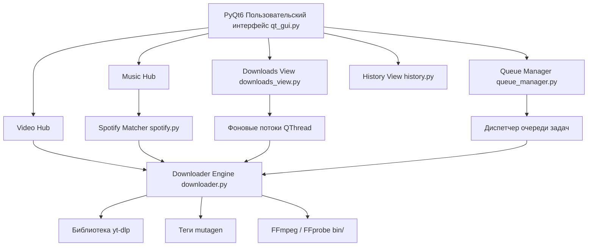

# Архитектура Media Downloader Pro

## 1. Обзор системы

**Media Downloader Pro** — это десктопное приложение для ОС Windows, созданное на базе **Python 3** и графического фреймворка **PyQt6**. Приложение предназначено для скачивания, конвертации и каталогизации медиаконтента (видео и аудио) с популярных веб-платформ.

---

## 2. Архитектурная схема



---

## 3. Структура проекта

```
PythonProject/
│
├── main.py                     # Точка входа в приложение
├── build_exe.py                # Скрипт сборки автономного .exe через PyInstaller
├── install_ffmpeg.py           # Автоматическая загрузка портативного FFmpeg
├── requirements.txt            # Зависимости проекта
├── .gitignore                  # Исключения версионного контроля
├── README.md                   # Документация проекта
├── ARCHITECTURE.md             # Описание архитектуры и компонентов
│
└── media_downloader/           # Основной пакет приложения
    ├── __init__.py             # Инициализация пакета
    ├── main.py                 # Внутренняя точка запуска
    ├── qt_gui.py               # Графический интерфейс PyQt6 (окна, виджеты, стили)
    ├── downloads_view.py       # Экран активных загрузок реального времени
    ├── downloader.py           # Обертка над yt-dlp, загрузка и постобработка
    ├── spotify.py              # Парсинг метаданных Spotify и поиск аудиопотоков
    ├── queue_manager.py        # Менеджер пакетной очереди задач
    ├── history.py              # Локальное хранилище истории загрузок (JSON)
    ├── theme_manager.py        # Цветовые темы оформления
    ├── utils.py                # Утилиты: форматирование, буфер обмена, FFmpeg
    └── bin/
        └── .gitkeep            # Директория для размещения ffmpeg.exe и ffprobe.exe
```

---

## 4. Ключевые компоненты и их ответственность

### `qt_gui.py` (Презентационный слой)
* **`MediaDownloaderWindow`**: Главное окно приложения с боковой навигационной панелью (`Sidebar`).
* **`VideoHubView` / `MusicHubView`**: Контейнеры с переключателями платформ и режимов («Одиночное видео/аудио» vs «Плейлист/Альбом»).
* **Потокобезопасность**: Загрузка и анализ медиа вынесены в отдельные фоновые потоки `QThread` (`AnalyzeWorker`, `DownloadWorker`, `ThumbnailWorker`). Обновление GUI происходит исключительно через сигналы `pyqtSignal`.

### `downloader.py` (Слой загрузки и обработки)
* Класс `MediaDownloader` инкапсулирует вызовы `yt-dlp`.
* Контролирует хуки прогресса (`progress_hook`), извлекает метаданные (название, автор, обложка, длительность, форматы).
* Выполняет постобработку: склейку видео и звука, конвертацию в MP3/FLAC/M4A, запись тегов.

### `spotify.py` (Интеграция Spotify)
* Использует технологию сопоставления метаданных: извлекает официальные метаданные (название, артист, альбом, обложка) через публичные эндпоинты Spotify Embed/oEmbed.
* Сопоставляет треки и загружает аудиопоток наивысшего качества, после чего вшивает оригинальные ID3-теги.

### `queue_manager.py` (Очередь задач)
* Реализует многопоточную последовательную очередь загрузки (`DownloadQueueManager`, `DownloadTask`).
* Поддерживает добавление задач в фоновом режиме, приостановку, возобновление и отмену.

### `history.py` (Хранение данных)
* Сохраняет историю скачанных файлов в формате JSON (`download_history.json`).
* Запись выполняется атомарно через временный файл, предотвращая повреждение данных при сбоях.

### `utils.py` (Вспомогательный уровень)
* Поиск и верификация бинарных файлов FFmpeg в системном `PATH`, папках проекта и сборке PyInstaller.
* Работа с системным буфером обмена (автоподстановка ссылок).
* Форматирование байтов, скорости и времени (ETA).
