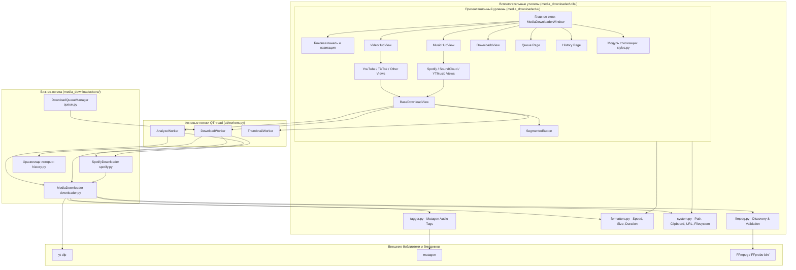

# Архитектура Media Downloader Pro

## 1. Обзор системы

**Media Downloader Pro** — десктопное приложение для ОС Windows, созданное на базе **Python 3** и графического фреймворка **PyQt6**. Приложение построено по модульному многослойному принципу с полным разделением логики представления (UI), бизнес-логики загрузки (Core) и системных утилит (Utils).

---

## 2. Архитектурная диаграмма



---

## 3. Модульная структура репозитория

```
PythonProject/
│
├── main.py                         # Корневая точка входа
├── build_exe.py                    # Скрипт сборки автономного .exe через PyInstaller
├── install_ffmpeg.py               # Автозагрузчик портативного FFmpeg
├── requirements.txt                # Зависимости проекта
├── .gitignore                      # Правила игнорирования Git
├── README.md                       # Пользовательская документация
├── ARCHITECTURE.md                 # Описание архитектуры и модулей
│
└── media_downloader/               # Основной пакет приложения
    ├── __init__.py                 # Метаданные пакета (версия)
    │
    ├── bin/
    │   └── .gitkeep                # Директория под бинарники ffmpeg.exe и ffprobe.exe
    │
    ├── core/                       # Ядро бизнес-логики приложения
    │   ├── __init__.py             # Экспорт ядра
    │   ├── downloader.py           # Движок yt-dlp загрузки и конвертации
    │   ├── spotify.py              # Модуль парсинга Spotify и аудио-сопоставления
    │   ├── queue.py                # Диспетчер пакетной очереди и задачи DownloadTask
    │   └── history.py              # Атомарное локальное хранилище истории загрузок
    │
    ├── ui/                         # Слой графического интерфейса PyQt6
    │   ├── __init__.py             # Экспорт компонентов слоя представления
    │   ├── styles.py               # Генератор QSS стилей под Material 3
    │   ├── theme_manager.py        # Менеджер палитр оформления
    │   ├── widgets.py              # Кастомные виджеты (SegmentedButton)
    │   ├── workers.py              # Фоновые потоки QThread (Analyze, Download, Thumbnail)
    │   ├── base_view.py            # BaseDownloadView и DetachedServiceWindow
    │   ├── downloads_view.py       # Экран активных загрузок в реальном времени
    │   ├── video_views.py          # Экраны видео: YouTube, TikTok, Другие сервисы, VideoHub
    │   ├── music_views.py          # Экраны музыки: Spotify, SoundCloud, YT Music, MusicHub
    │   └── main_window.py          # Главное окно MediaDownloaderWindow и функция run_gui
    │
    └── utils/                      # Модульный пакет утилит
        ├── __init__.py             # Единый экспорт утилит
        ├── ffmpeg.py               # Обнаружение и валидация FFmpeg/FFprobe
        ├── formatters.py           # Форматирование скорости, размера, длительности
        ├── system.py               # Буфер обмена, директории, санитизация имен файлов
        └── tagger.py               # Запись ID3-тегов и обложек через Mutagen
```

---

## 4. Архитектурные принципы

1. **Модульность и высокая связность (High Cohesion, Low Coupling)**:
   * **UI-слой (`media_downloader/ui/`)**: Отвечает исключительно за отображение виджетов, темы, анимацию, сбор параметров пользователя и реагирование на события через сигналы Qt.
   * **Core-слой (`media_downloader/core/`)**: Изолирован от графических библиотек Qt. Содержит бизнес-логику управления загрузками, очереди, интеграции со Spotify и хранилища истории.
   * **Utils-слой (`media_downloader/utils/`)**: Набор чистых, переиспользуемых функций без побочных эффектов: форматирование величин, нативный доступ к Win32 буферу обмена, проверка URL и поиск внешних утилит.
2. **Чистая файловая структура**:
   * Пакет `media_downloader` освобожден от лишних разрозненных файлов в корне: все компоненты строго распределены по трем функциональным пакетам (`core`, `ui`, `utils`).
3. **Потокобезопасная асинхронность (Thread Safety & UI Responsiveness)**:
   * Все длительные сетевые и дисковые операции выполняются строго в фоновых потоках `QThread`.
   * Передача прогресса, статусов и ошибок в GUI осуществляется исключительно через потокобезопасные сигналы `pyqtSignal`, что исключает зависание окон.
4. **Отказоустойчивость и атомарность данных**:
   * Запись истории в `core/history.py` производится атомарно через временный файл `.tmp` с вызовом `fsync` и заменой `os.replace`, предотвращая потерю данных при сбоях ОС или завершении процесса.
