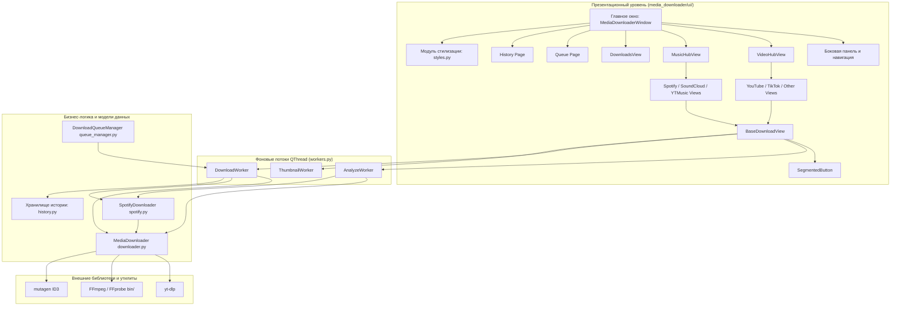

# Архитектура Media Downloader Pro

## 1. Обзор системы

**Media Downloader Pro** — десктопное приложение для ОС Windows, созданное на базе **Python 3** и графического фреймворка **PyQt6**. Приложение построено по модульному многослойному принципу с четким разделением логики представления (UI), бизнес-логики загрузки и вспомогательных утилит.

---

## 2. Архитектурная диаграмма



---

## 3. Модульная структура репозитория

```
PythonProject/
│
├── main.py                         # Корневая точка входа
├── build_exe.py                    # Скрипт сборки автономного .exe через PyInstaller
├── install_ffmpeg.py               # Автозагрузчик портативного FFmpeg
├── requirements.txt                # Зависимости проекта
├── .gitignore                      # Правила игнорирования Git
├── README.md                       # Пользовательская документация
├── ARCHITECTURE.md                 # Описание архитектуры и модулей
│
└── media_downloader/               # Основной пакет приложения
    ├── __init__.py                 # Инициализация пакета
    ├── main.py                     # Внутренний запуск
    ├── qt_gui.py                   # Фасад обратной совместимости для UI
    ├── downloader.py               # Ядро загрузки и постобработки на базе yt-dlp
    ├── spotify.py                  # Модуль сопоставления метаданных Spotify
    ├── queue_manager.py            # Диспетчер очереди задач
    ├── history.py                  # Локальное хранилище истории (атомарный JSON)
    ├── downloads_view.py           # Экран активных загрузок реального времени
    ├── theme_manager.py            # Менеджер палитр оформления
    ├── utils.py                    # Утилиты: буфер обмена, FFmpeg, форматирование
    │
    ├── bin/
    │   └── .gitkeep                # Директория под бинарники ffmpeg.exe и ffprobe.exe
    │
    └── ui/                         # Декомпозированный слой интерфейса PyQt6
        ├── __init__.py             # Экспорт компонентов слоя представления
        ├── styles.py               # Генератор QSS стилей под Material 3
        ├── widgets.py              # Кастомные виджеты (SegmentedButton)
        ├── workers.py              # Фоновые потоки QThread (Analyze, Download, Thumbnail)
        ├── base_view.py            # BaseDownloadView и DetachedServiceWindow
        ├── video_views.py          # Экраны видео: YouTube, TikTok, Другие сервисы, VideoHub
        ├── music_views.py          # Экраны музыки: Spotify, SoundCloud, YT Music, MusicHub
        └── main_window.py          # MediaDownloaderWindow и функция run_gui
```

---

## 4. Архитектурные принципы рефакторинга

1. **Разделение ответственности (Single Responsibility Principle)**:
   * Монолитный модуль интерфейса `qt_gui.py` декомпозирован на специализированные модули: общие стили (`styles.py`), кастомные виджеты (`widgets.py`), многопоточные обработчики (`workers.py`), базовый класс экранов (`base_view.py`), а также изолированные экраны видео (`video_views.py`) и музыки (`music_views.py`).
2. **Паттерн Фасад (Facade Pattern)**:
   * Модуль `media_downloader.qt_gui` сохранен как легкий фасад, который реэкспортирует классы из пакета `ui`. Это гарантирует 100% обратную совместимость с внешними скриптами запуска и сборки.
3. **Потокобезопасная асинхронность (Thread Safety & UI Responsiveness)**:
   * Все длительные сетевые и дисковые операции (извлечение метаданных, загрузка видео/аудио, скачивание обложек, конвертация кодеков) выполняются строго в фоновых потоках `QThread`.
   * Передача прогресса, статусов и ошибок в GUI осуществляется исключительно через сигналы `pyqtSignal`, что исключает зависание интерфейса.
4. **Отказоустойчивость и безопасность данных**:
   * Запись истории в `history.py` производится атомарно через запись во временный файл с последующим замещением, защищая историю от повреждений при внезапном закрытии программы.
   * Централизованный перехватчик исключений в `setup_safe_exception_handling` предотвращает краши процесса при системных сообщениях Qt.
